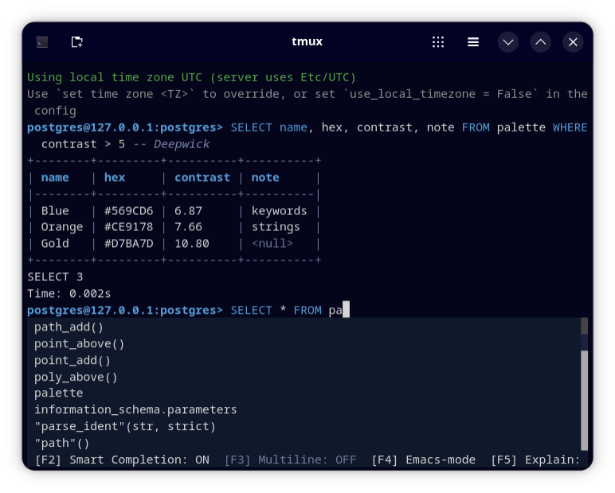

# Deepwick for pgcli

Deepwick colors for [pgcli](https://www.pgcli.com).

> Deepwick is an unofficial theme derived from
> [Polywick Blue](https://vscode.polywickstudio.net) by Polywick Studio (MIT).
> Not affiliated with Polywick Studio.



## Install

pgcli takes its syntax colors from a Pygments style, so install this repo
into pgcli's environment:

```sh
uv tool install pgcli --with git+https://github.com/deepwick/pgcli
```

or, with pipx:

```sh
pipx inject pgcli git+https://github.com/deepwick/pgcli
```

## Activate

Edit `~/.config/pgcli/config`:

1. Under `[main]`, set `syntax_style = deepwick`.
2. Replace the whole existing `[colors]` section with the one from
   `deepwick.pgclirc`. Don't add a second `[colors]` section; pgcli refuses
   to start with two.

For 24-bit color in the prompt, set this in your shell rc file:

```sh
export PROMPT_TOOLKIT_COLOR_DEPTH=DEPTH_24_BIT
```

Without it the prompt uses the nearest 256 colors. Table output uses 24-bit
color whenever `COLORTERM` is `truecolor`.

## Notes

- SQL follows the Deepwick syntax roles: keywords Blue, types Teal, strings
  Orange, quoted identifiers Light Blue, numbers Sage, comments Comment
  italic.
- Prompt bold Blue; completion menu Foreground on Surface, current item on
  Selection; toolbar on Surface with transaction state Green or Red.
- Table headers bold Blue, borders Muted, `<null>` Muted.
- If `syntax_style = deepwick` is set but the package isn't installed, pgcli
  silently uses `native`.
- The style also works with other Pygments tools, e.g.
  `pygmentize -O style=deepwick`.

Tested with pgcli 4.6.0.

## License

MIT. See [LICENSE](LICENSE).
